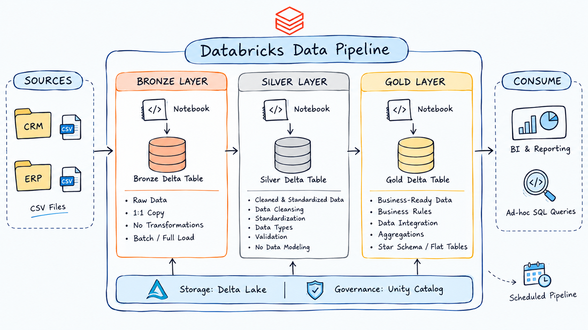

# Databricks Lakehouse and Analytics Project

Welcome to the **Databricks Lakehouse and Analytics Project** repository! 🚀

This project demonstrates an end-to-end data engineering solution built with Databricks and Apache Spark, from ingesting raw CRM and ERP data to building a structured Lakehouse and connecting it to Power BI for interactive analytics and reporting.

Designed as a portfolio project, it highlights modern data engineering practices, data quality, data integration, dimensional modeling, and business intelligence.

---

## 🏗️ Data Architecture

The project follows the **Medallion Architecture**, consisting of three layers: **Bronze, Silver, and Gold**.



1. **Bronze Layer:** Stores raw data ingested from CRM and ERP CSV files into Delta tables in Databricks.
2. **Silver Layer:** Applies data cleansing, standardization, deduplication, validation, and integration to improve data quality.
3. **Gold Layer:** Contains business-ready dimension and fact tables modeled using a Star Schema for analytical queries and reporting.
4. **Power BI:** Connects to the Gold layer to build interactive dashboards and visualize business performance.

---

## 📖 Project Overview

This project involves:

1. **Data Architecture:** Designing a Lakehouse using the Medallion Architecture.
2. **Data Ingestion:** Loading CRM and ERP source files into Databricks.
3. **ETL Pipelines:** Transforming and processing data using PySpark and Spark SQL.
4. **Data Quality:** Applying validation, cleansing, standardization, and deduplication rules.
5. **Data Modeling:** Building fact and dimension tables optimized for analytical workloads.
6. **Data Storage:** Using Delta Lake tables to manage processed data.
7. **Analytics & Reporting:** Connecting the Gold layer to Power BI to create interactive dashboards and business reports.

🎯 This repository demonstrates practical experience in:

- Data Engineering
- Databricks and Apache Spark
- PySpark Development
- Spark SQL
- Lakehouse Architecture
- Medallion Architecture
- ETL Pipeline Development
- Delta Lake
- Data Quality and Data Integration
- Dimensional Data Modeling
- Power BI and Business Intelligence

---

## 🛠️ Important Links & Tools

- **[Databricks](https://www.databricks.com/):** Lakehouse platform for data engineering and analytics.
- **[Apache Spark](https://spark.apache.org/):** Distributed data processing engine.
- **[PySpark Documentation](https://spark.apache.org/docs/latest/api/python/):** Python API for Apache Spark.
- **[Delta Lake](https://delta.io/):** Open-source storage framework for reliable data processing.
- **[Power BI](https://powerbi.microsoft.com/):** Business intelligence platform for interactive reports and dashboards.
- **[GitHub](https://github.com/):** Version control and project collaboration.
- **[Draw.io](https://www.drawio.com/):** Designing architecture diagrams, data flows, and data models.

---

## 🚀 Project Requirements

### Building the Lakehouse (Data Engineering)

#### Objective

Develop a modern Lakehouse using Databricks to consolidate CRM and ERP data, improve data quality, and prepare reliable datasets for analytical reporting and business decision-making.

#### Specifications

- **Data Sources:** Import data from two source systems, CRM and ERP, provided as CSV files.
- **Data Ingestion:** Load source data into the Bronze layer using PySpark.
- **Data Quality:** Cleanse and resolve data quality issues before analysis.
- **Data Integration:** Combine data from CRM and ERP into a unified analytical model.
- **Data Storage:** Store processed datasets in Delta tables.
- **Data Modeling:** Build dimension and fact tables using a Star Schema.
- **Scope:** Focus on the latest dataset; historical data tracking is not required.
- **Documentation:** Document the data model, transformations, and architecture.

---

### 🥉 Bronze Layer — Raw Data Ingestion

The Bronze layer is responsible for loading the original CRM and ERP source files into Databricks.

Key activities:

- Reading CSV files from Databricks Volumes.
- Creating PySpark DataFrames.
- Saving raw datasets as Delta tables.
- Organizing source tables under the Bronze schema.

### 🥈 Silver Layer — Data Cleansing and Integration

The Silver layer prepares reliable and consistent data for analytical processing.

Key activities:

- Handling missing and invalid values.
- Removing duplicate records.
- Standardizing text values and data formats.
- Validating dates and business rules.
- Integrating CRM and ERP datasets.
- Checking data consistency and relationships.

### 🥇 Gold Layer — Dimensional Modeling

The Gold layer provides business-ready data using a Star Schema.

**Dimension Tables:**

- `gold.dim_customers`
- `gold.dim_products`

**Fact Table:**

- `gold.fact_sales`

Key activities:

- Creating surrogate keys for dimensions.
- Integrating customer and product attributes.
- Defining relationships between dimensions and fact data.
- Preparing datasets for efficient analytical queries.

---

### 📊 BI: Analytics & Reporting (Power BI)

#### Objective

Connect Power BI to the Gold layer in Databricks to create interactive reports and dashboards that turn processed data into actionable business insights.

#### Specifications

- **Data Connectivity:** Connect Power BI to the Gold tables in Databricks.
- **Customer Analytics:** Analyze customer information and behavior.
- **Product Analytics:** Evaluate product performance and contribution to sales.
- **Sales Analytics:** Explore sales performance and trends.
- **Data Visualization:** Build interactive dashboards with business KPIs and filters.
- **Decision Support:** Present insights that help stakeholders understand business performance and make informed decisions.

The Gold layer serves as the analytics-ready data source, while Power BI provides the visualization and reporting layer.

---

## 📂 Repository Structure

```text
databricks-lakehouse-project/
│
├── datasets/                         # Raw CRM and ERP source files
│
├── docs/                             # Project documentation and diagrams
│   ├── data_architecture.png         # Medallion architecture diagram
│   ├── data_architecture.drawio      # Editable architecture diagram
│   ├── data_flow.drawio              # Data flow diagram
│   ├── data_models.drawio            # Star Schema data model
│   ├── data_catalog.md               # Dataset and column descriptions
│   └── requirements.md               # Project requirements
│
├── notebooks/                        # Databricks notebooks
│   ├── 01_bronze_ingestion.py         # Source data ingestion
│   ├── 02_silver_transformation.py    # Cleansing and integration
│   └── 03_gold_modeling.py            # Dimensions and fact tables
│
├── sql/                              # Spark SQL scripts
│   ├── silver/                       # Silver transformations
│   └── gold/                         # Gold data modeling
│
├── powerbi/                          # Power BI reports and related files
│   └── sales_analytics.pbix          # Power BI report (when available)
│
├── tests/                            # Data quality and validation tests
│
├── README.md                         # Project documentation
├── LICENSE                           # License information
└── .gitignore                        # Files excluded from Git
```

*The repository structure may be adjusted to reflect the actual files and implementation.*

---

## 🔄 End-to-End Data Flow

```text
CRM & ERP CSV Files
        |
        v
Databricks Volumes
        |
        v
Bronze Delta Tables
        |
        v
Silver Transformation
(PySpark / Spark SQL)
        |
        v
Gold Delta Tables
(Dimensions & Fact)
        |
        v
Power BI
        |
        v
Interactive Dashboards
& Business Insights
```

---

## 🚀 Getting Started

### Prerequisites

- Access to a Databricks workspace.
- CRM and ERP CSV datasets.
- Basic knowledge of Python, SQL, and Apache Spark.
- Appropriate permissions to create and manage Databricks tables.
- Power BI Desktop for report development.

### Implementation Steps

1. Configure the Databricks workspace and data storage.
2. Upload or make the CRM and ERP CSV files accessible through Databricks Volumes.
3. Read the source files using PySpark and create Bronze Delta tables.
4. Apply cleansing, standardization, validation, and integration in the Silver layer.
5. Create Gold dimension and fact tables.
6. Validate the resulting Star Schema and data quality.
7. Connect Power BI to the Gold layer using a supported Databricks connection method.
8. Build interactive dashboards and analytical reports.

---

## 🔮 Future Improvements

- Implement incremental data ingestion.
- Add automated data quality checks and pipeline logging.
- Use Delta Lake features such as `MERGE` and Time Travel where appropriate.
- Automate pipeline execution using Databricks Workflows.
- Apply Unity Catalog for data governance and access control.
- Implement CI/CD practices for notebooks and SQL scripts.
- Enhance Power BI dashboards with additional KPIs and business metrics.

---

## ☕ Stay Connected

Let's stay in touch! Feel free to connect with me on the following platforms:

[](https://www.youtube.com/@abdosemhan9855)
[](https://www.linkedin.com/in/abdulrahman-samhan/)
[](https://abdulrahmansamhan.journoportfolio.com/)
[](mailto:abdosemhan28@gmail.com)
[](https://github.com/AbdulrahmanSamhan)

---

## 🛡️ License

This project is licensed under the [MIT License](LICENSE). You are free to use, modify, and share this project with proper attribution.

---

## 🌟 About Me

Hi there! I'm **Abdulrahman Samhan**, an **Analytics Engineer, Data Engineer, and BI Developer**.

I'm passionate about transforming raw data into meaningful insights, building reliable data pipelines, designing analytical data models, and developing interactive dashboards that support better decision-making.

Through my projects and mentoring activities, I enjoy sharing knowledge and helping aspiring data professionals develop practical skills in data analytics, business intelligence, and data engineering.
